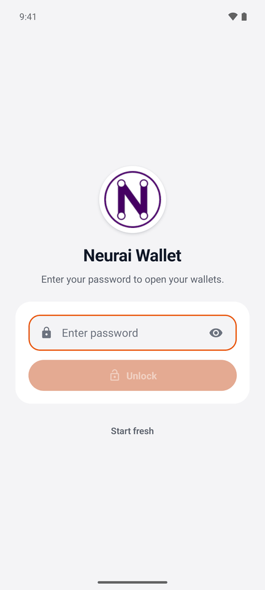
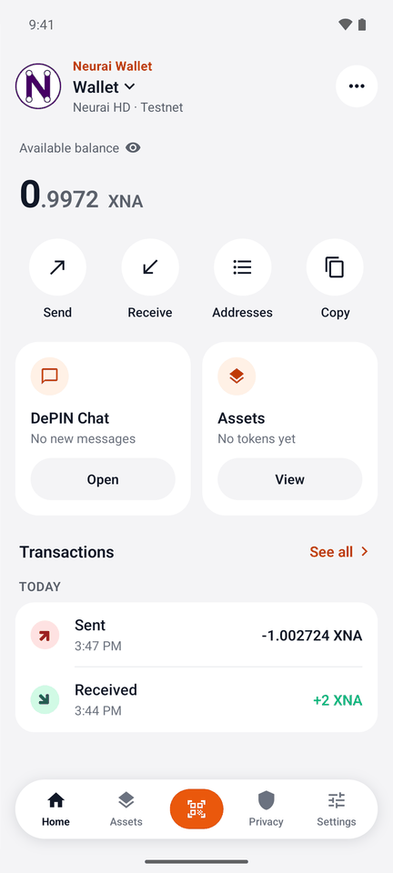
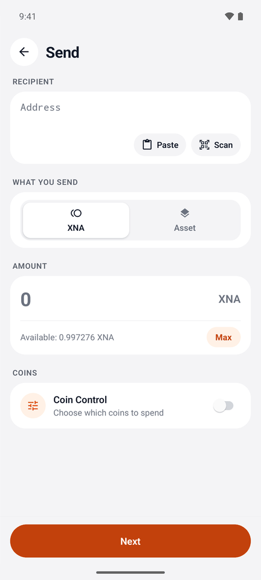
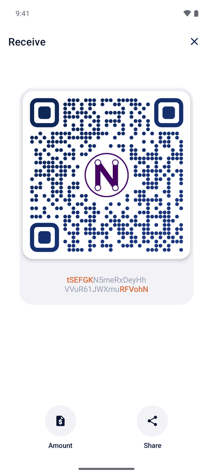
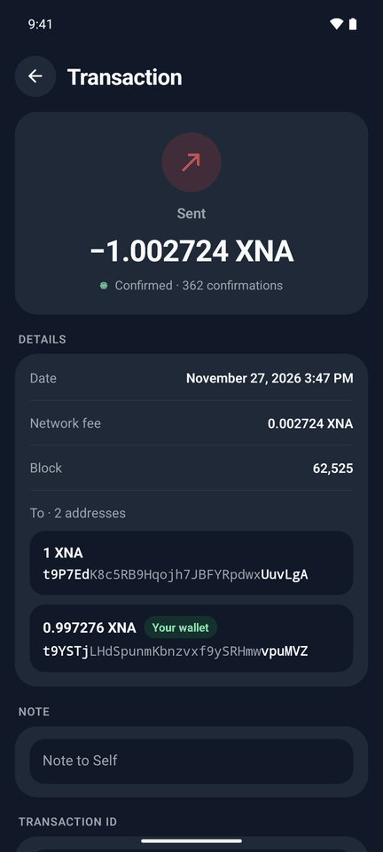
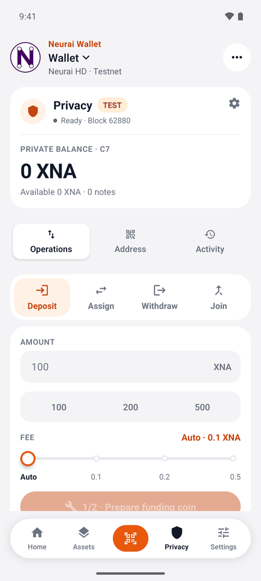
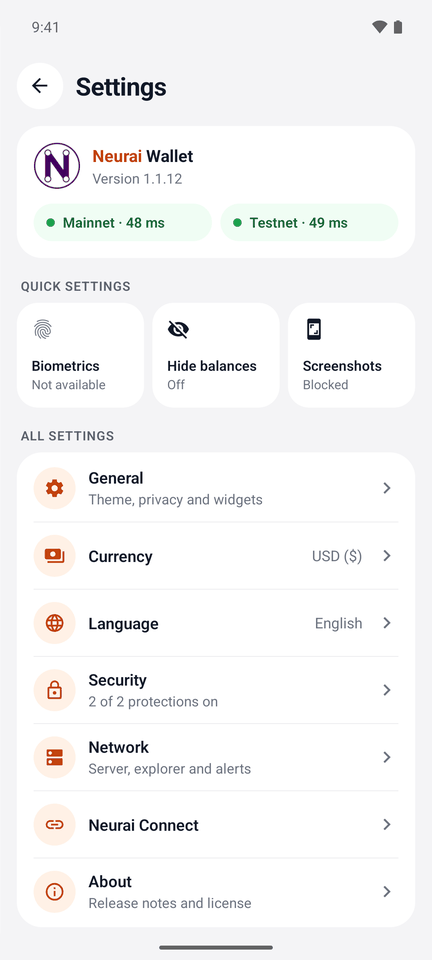
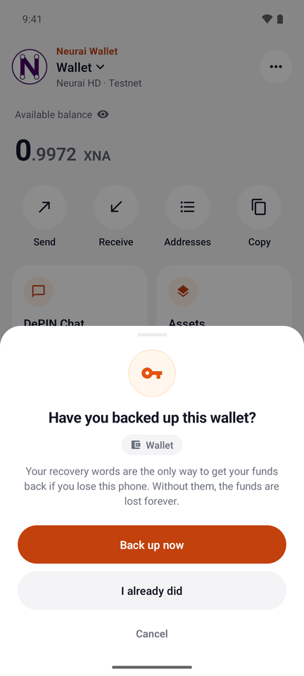

# NeuraiWallet

A mobile wallet for the [Neurai](https://neurai.org) blockchain, built with React Native.
Android is the shipping platform (Google Play); the iOS, watchOS and Mac Catalyst targets stay in
the tree but are not published yet. Software wallets generate their words on the device and keep
them in the platform secure store (encrypted again with the app password when one is set); the
JavaScript layer handles them to derive keys and sign. Hardware wallets keep the seed on the ESP32
signer (when a device is set up from the app, the words pass through the phone's memory on the way
to it). No seed or private key is sent to a server.

NeuraiWallet is a fork of [BlueWallet](https://github.com/BlueWallet/BlueWallet). The
navigation shell, the theming, the encrypted storage and the settings screens come from there;
the wallet, transaction, asset and messaging layers are Neurai's own and are built on the
`@neuraiproject/*` libraries (`neurai-key`, `neurai-jswallet`, `neurai-create-transaction`,
`neurai-sign-transaction`, `neurai-depin-msg`, `neurai-message`, `neurai-silent-payments`).

## Screenshots

This version redesigns the interface. The home shows the wallet's balance, its shortcuts and the
latest transactions, with a bottom bar for Home, Assets, the QR scanner, Privacy and Settings.
Send, Receive, the transaction screen, the settings and the unlock screen were redesigned, and the
app's messages and confirmations are now bottom sheets in the same style instead of system
dialogs. The light and dark themes follow the phone or are set in Settings → General.

<table>
  <tr>
    <td align="center"><br><sub>Unlock</sub></td>
    <td align="center"><br><sub>Home</sub></td>
    <td align="center"><br><sub>Send</sub></td>
    <td align="center"><br><sub>Receive</sub></td>
  </tr>
  <tr>
    <td align="center"><br><sub>Transaction (dark theme)</sub></td>
    <td align="center"><br><sub>Privacy pool (testnet)</sub></td>
    <td align="center"><br><sub>Settings</sub></td>
    <td align="center"><br><sub>Messages as bottom sheets</sub></td>
  </tr>
</table>

<sub>Testnet wallet on the Android emulator.</sub>

## What it does

* **HD wallets** on Neurai's BIP44 path, created from a 12-word mnemonic or imported from one.
* **ECDSA wallets** with bech32m witness v3 addresses (`m/84'`), on testnet for now.
* **Post-quantum wallets** signed with ML-DSA-44, using bech32m `AuthScript` addresses.
* **Hardware wallet** support over USB serial for the Neurai ESP32 signer: the device holds the
  seed and signs; the phone builds and broadcasts. Setting a device up from the app generates or
  takes the words on the phone and sends them over USB once.
* **Neurai Assets** — the native tokens of the chain (root, sub, unique/NFT, owner, restricted,
  qualifier and DePIN assets) are listed per wallet and can be sent from the Send screen.
* **Silent payments (NIP-047)** — ECDSA wallets show a reusable payment code (`nsp1…`, `tnsp1…` on
  testnet) and find the payments made to it. Software wallets can pay a code (XNA only); Legacy
  and PQ coins go in two transactions through the wallet's own ECDSA bridge address, both saved
  before the first is sent, and the home offers to finish a payment left halfway.
* **DePIN messaging** — a token-gated chat, opened from its card on the home (see below).
* **Neurai Connect** — QR login and dApp sessions (see below).
* **Privacy pool (C7, testnet)** — private XNA notes with zero-knowledge proofs built on the
  phone (see below).
* **App password** — with a password set, the wallet store is encrypted with Argon2id (64 MiB,
  3 passes) and XChaCha20-Poly1305 from libsodium, built into the Android app. Stores written by
  older versions keep opening and can be moved to the new format after unlocking or from
  Settings → Security. See [`SECURITY.md`](SECURITY.md).
* **Android widgets** — Neurai Price and Neurai Market: the XNA price in the app's currency, its
  24-hour change, market cap and volume, from CoinGecko.
* Inherited from BlueWallet and still in use: biometric unlock on the sensitive screens, "is it my
  address?" verification, raw transaction broadcast, fiat rates and 50+ UI languages. (The
  decoy-storage "plausible deniability" feature was removed; a store that still holds a decoy
  keeps opening with each password.)

## Networks

Six chain identifiers are wired in parallel, one per network for each wallet kind: Legacy
P2PKH, ECDSA witness v3 and post-quantum. Switching the active network changes the backend URL,
the address prefixes, the BIP44 coin type and the bech32m HRP in one step. They are defined in
`blue_modules/neurai/networkConfig.ts`:

| Chain | Network | Keys | Addresses | BIP44 coin type |
| --- | --- | --- | --- | --- |
| `xna` | mainnet | legacy ECDSA (secp256k1) | base58, P2PKH version 53 (`N…`) | 1900 |
| `xna-test` | testnet | legacy ECDSA (secp256k1) | base58, P2PKH version 127 | 1 |
| `xna-ecdsa` | mainnet | ECDSA (secp256k1), `m/84'` | bech32m strict ECDSA v3, HRP `nq` (`nq1r…`) | 1900 |
| `xna-ecdsa-test` | testnet | ECDSA (secp256k1), `m/84'` | bech32m strict ECDSA v3, HRP `tnq` (`tnq1r…`) | 1 |
| `xna-pq` | mainnet | post-quantum ML-DSA-44 | bech32m AuthScript v1, HRP `nc` (`nc1p…`) | 1900 |
| `xna-pq-test` | testnet | post-quantum ML-DSA-44 | bech32m strict PQ v2, HRP `tpq` (`tpq1z…`) | 1 |

These are the app's own names. `neurai-key` 5 reuses `xna` / `xna-pq` for other address types,
so every direct call goes through `blue_modules/neurai/keyNetwork.ts`; the Legacy and mainnet PQ
derivations are unchanged (mainnet PQ addresses keep their commitment, re-encoded from the old
`nq1p…`). Testnet was reset with a new genesis: testnet PQ wallets moved to the node's strict PQ
type, and cached testnet state (balances, history, DePIN pins and sessions) from the old chain is
discarded on load (`AbstractNeuraiWallet.fromJson`, `blue_modules/neurai/testnetReset.ts`).

ECDSA and PQ wallets can only be created on testnet for now: the node accepts witness v3 and v2
outputs only where those families are active, so the mainnet options stay disabled until then.
ECDSA wallets use ordinary compressed secp256k1 keys. DePIN RPC 6 supports both Legacy and strict ECDSA chat identities; PQ messaging remains deferred.

Balances, history, UTXOs and broadcast go through `neurai-wallet-services` over WSS by default
(`blue_modules/neurai/WssBackend.ts`), with a JSON-RPC backend as an explicit fallback
(`RpcBackend.ts`). Both endpoints can be overridden per network from Settings → Network.

## DePIN messaging

Neurai's DePIN assets (`&NAME`) carry a chat: holders of the same token can message each other
end to end encrypted, relayed by a DePIN-enabled Neurai node rather than by a server of ours.
The app derives a dedicated account-100 chat identity: `m/44'/coin'/100'/0/0` for Legacy wallets and `m/84'/coin'/100'/0/0` for ECDSA wallets. The selected exact address is passed to neurai-depin-msg 5.x; a key is not silently changed to its Legacy alias.

Requests use DePIN RPC 6 with ECIES format-3 envelopes over the WSS service (the wallet's, or one set for DePIN alone; a plain `ws://` server is accepted only at a 192.168.0.x or 192.168.1.x address on the local network, the same hosts Android lets through without TLS). Bootstrap pins the expected genesis, pool key and root. Every addressed call signs all arguments and the verified instance/membership context; replies are authenticated against the locally computed request hash before decryption. The WSS backend includes `depin.receive_seq` and serializes cursor integers exactly.

Reads use admission sequences instead of sender timestamps/hashes. The full cursor is kept with its decrypted history in memory, scoped to the endpoint/address/token. Nonces cannot cross an instance/revision, address or scope. Membership changes refresh recipients and renew challenges; a read has one bounded recovery attempt. A changed stream restarts pagination with hash deduplication. Late messages with old sender timestamps are not skipped, and bounded page loops continue on the next poll.

The recipient picker reads a verified directory. Private messages select the exact recipient plus the sender, including ECDSA destinations, even if the complete group is larger than a single message allows. Group limits and complete-directory requirements are enforced locally. Group sends rebuild once only after an authenticated membership/recipient rejection; an ambiguous submission result is never retried automatically. The existing independent recipient audit remains advisory; a pool signature is not independent proof of asset ownership.

A one-tap reveal spends from the chat identity to publish its key. Settings select the wallet service endpoint. PQ messaging is not enabled. Hardware (ESP32) messaging needs firmware with DePIN RPC 6 / format 3; older firmware is reported as unsupported instead of falling back to obsolete reads.

The published `@neuraiproject/neurai-rpc@0.10.0` and `@neuraiproject/neurai-depin-msg@5.0.0` are installed from npm. Exact versions and registry integrity are pinned in `package-lock.json`.

## Neurai Connect

Neurai Connect is the wallet ↔ web link: a site shows a QR code, the user scans it with
NeuraiWallet, approves on the phone, and the site is either logged in ("Sign in with Neurai",
a CAIP-122 message signed with the chosen address) or holds a dApp session it can later use to
ask the wallet for `getAccountAddresses` and `signMessage`. Legacy and ECDSA software wallets also
answer `signPsbt` and `neurai_getAccountXpub` when the site lists them as optional methods
(`sendTransfer` is declared by the `bip122` profile but not implemented yet). Traffic goes through a relay
that only ever sees opaque encrypted blobs and random topics; no private key leaves the device.

- **`signPsbt`**: the wallet decodes the PSBT before anything is signed. It shows every output
  with its address and asset, what comes back to the wallet, what leaves it and the fee
  (`blue_modules/neurai/connect/psbt.ts`). It signs only the requested inputs of its own addresses,
  only with SIGHASH_ALL, and returns `partialSig` entries for the site to finalize. It never broadcasts.
  Post-quantum inputs are refused, because a PSBT has no field for an ML-DSA-44 signature.
- **`neurai_getAccountXpub`** (Neurai extension): after the user approves, the wallet returns
  `{ xpub, path, addressType }` for account 0: `m/44'/coin'/0'` for Legacy and `m/84'/coin'/0'` for ECDSA
  (`blue_modules/neurai/connect/xpub.ts`). With it, a site sees every receive (`0/i`) and change (`1/i`)
  address but cannot spend. The wallet shares the account key, never the master key.
The wallet side lives in `blue_modules/neurai/connect/` (relay client, session storage, signer,
per-domain identities) with the approval screens in `screen/connect/`, and pairings arrive as
`nc:` URIs from the scanner or as `neuraiwallet://connect?uri=…` deep links, recognised by
`class/neurai-uri-match.ts`.

## Privacy pool (C7, testnet)

For testnet Legacy, ECDSA and PQ wallets with their words, the **Privacy** tab of the bottom bar
opens the TEST pool pinned in `blue_modules/neurai/privacy/c7-testnet.json` (the same instance as
the web wallet), `C7TEST1106A#POOL` of the testnet restarted on 2026-11-05, with its private
balance and encrypted history. For other wallets the tab says why the pool is not available. C7 is NeuraiZK/v3: one private wallet with any number of
unlinkable `tnzk1…` version 3 addresses and fast recovery (one curve multiplication per published
note, no address gap). It reuses the C6 circuits and proving files, and the instance is checked
against its verifiable birth (its domain must derive from the genesis, the UNIQUE emission and
the pool name). `@neuraiproject/neurai-privacy` runs C7 only since 0.4.0 (0.4.2 is pinned), so the
C6 XNA and asset pools are gone.

Deposit, assign to `tnzk1…` addresses, withdraw and join two notes.

Hermes has no WebAssembly, so the proving side of `@neuraiproject/neurai-privacy` (snarkjs,
Argon2id, pool scanning) runs in a hidden WebView (`components/privacy/PrivacyHost.tsx`). Its
page is bundled from `privacy-host/` by `npm run privacy:host` (run by `postinstall`) into the
git-ignored `blue_modules/neurai/privacy/hostHtml.generated.ts`. The app keeps the library's
worker client, the encrypted journals (`privacy/store.ts`), RPC through the wallet's WSS service
and signing (`privacy/wallet.ts`); `privacy/bridge.ts` relays the worker's messages.

The proving files (~88 MB per instance) are downloaded on first use and kept only if their size
and SHA-256 match the pins in the app, so any HTTPS host will do. By default they come from the
testnet web wallet, which deploys the same pinned files (`https://webwallet-testnet.neurai.org`
plus the manifest's `artifactBaseUrl`, `/privacy-c7/`); the URL can be changed in the privacy
screen. To mirror them to a GitHub release (`c7-test-<commitment[0:12]>`) instead:

```bash
node scripts/privacy-artifacts-release.mjs c7 ../neurai-webwallet/public/privacy-c7
# verified? add --publish (needs an authenticated GitHub CLI)
```

`privacy-host/e2e/run.sh <artifacts-dir>` checks the WebView page end to end in headless
Chromium (Docker): private wallet derivation, a real pool scan on testnet and a real Groth16
deposit proof whose files cross the bridge.

## Build and run

Node 22.11.0 or newer is required (see the `engines` field in `package.json`). Check yours with
`node --version && npm --version`.

```bash
git clone https://github.com/neuraiproject/NeuraiWallet.git
cd NeuraiWallet
npm ci
```

`npm ci` installs the exact versions pinned in `package-lock.json`, applies the native patches in
`patches/` and builds the privacy host page. It stops if a patch does not apply.

The Android app includes a subset of libsodium 1.0.22 for the store encryption, vendored
unmodified in `android/walletcrypto` and checked against the signed release
(`npm run lint:libsodium` fails on any edit). Update it only with
`scripts/update-libsodium.sh <version>`: it verifies the release signature and the pinned test
vectors before replacing anything.

Start the Metro bundler in one terminal:

```bash
npm start
```

Then, in another terminal:

```bash
npm run android        # build and install on a connected device or emulator
npm run ios            # build and run on the iOS simulator
```

For iOS you need the CocoaPods dependencies first (`npx pod-install`), and for macOS via Mac
Catalyst open `ios/BlueWallet.xcworkspace` in Xcode and run the `BlueWallet` scheme (the Xcode
project still carries the upstream name). The Apple targets are not released yet: they have no
native encryption module and keep the older store format.

Useful extras while developing:

```bash
npm run adb              # adb reverse tcp:8081, so a device can reach Metro
npm run android:relaunch # force-stop and relaunch the installed app
npm run clean            # gradle clean + wipe caches and node_modules, then npm i
npm run clean:ios        # wipe node_modules and Pods, reinstall, reset the Metro cache
npm run android:clean    # gradle clean, then rebuild and run on Android
```

## Tests

```bash
npm test             # everything: lint + unit + integration
npm run lint         # tsc (app and privacy host), unused loc keys, vendored libsodium, then eslint
npm run lint:eslint  # eslint alone; npm run lint:fix applies its fixes
npm run unit         # jest, every tests/unit/*.test.* file
npm run integration  # jest tests/integration (a local server, runs offline)
```

The unit suite is the one to run while working; it is self-contained and mocks the native
modules in `tests/setup.js`. Storage tests use `tests/unit/helpers/storage-double.ts`, which
simulates the secure store and the Realm backup with their failure modes. No test needs
secrets or a live network. End-to-end tests use Detox on Android; the inherited specs under
`tests/e2e/` still target removed Bitcoin flows:

```bash
npm run e2e:debug         # build a debug APK if needed, then run the e2e suite
npm run e2e:release-test  # run the suite against a release build
```

## Where the code lives

| Directory | What is in it |
| --- | --- |
| `components/` | React components (the home in `components/home/`, the privacy pool in `components/privacy/`, the app's messages in `AppDialog.tsx`) and the context providers (`SettingsProvider`, `StorageProvider`) |
| `class/` | Core business logic, including the wallet implementations in `class/wallets/` |
| `blue_modules/` | Utility modules: currency, encryption, filesystem, and the Neurai network layer in `blue_modules/neurai/` and the ESP32 driver in `blue_modules/neurai-hw/` |
| `screen/` | Screens grouped by feature: `wallets`, `send`, `receive`, `transactions`, `settings`, `connect` |
| `navigation/` | React Navigation setup and the typed param lists |
| `hooks/` | Custom hooks (`useStorage`, `useSettings`, `useBiometrics`, the DePIN chat hooks, …) |
| `loc/` | Localisation; `loc/en.json` is the source, alongside 50+ translations |
| `models/` | Type definitions for units, fiat currencies and block explorers |
| `tests/` | `tests/unit/`, `tests/integration/` and `tests/e2e/` |
| `android/`, `ios/` | The native projects; `android/walletcrypto/` holds the vendored libsodium and its JNI bridge |
| `codegen/` | Specs of the app's own native modules (`WalletCrypto`) |
| `privacy-host/` | The WebView page that runs the privacy pool's proving code |
| `scripts/` | Build, lint and maintenance scripts (libsodium update, privacy proving files) |

Conventions for contributors are in [`CONTRIBUTING.md`](CONTRIBUTING.md). Common questions are
answered in [`FAQ.md`](FAQ.md).

## Licence

MIT. See [`LICENSE`](LICENSE). NeuraiWallet derives from BlueWallet, which is also MIT licensed.
