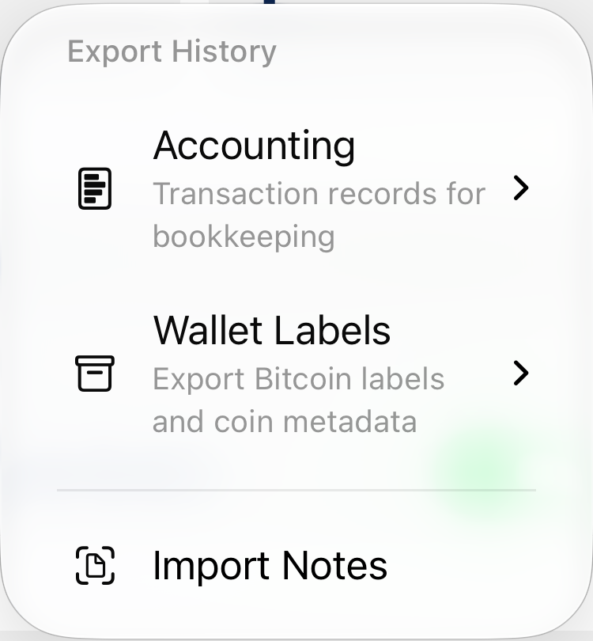
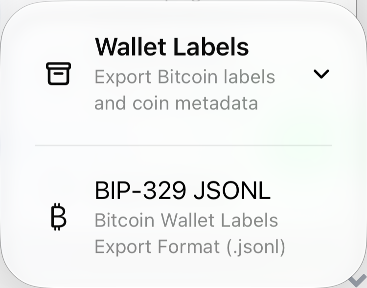
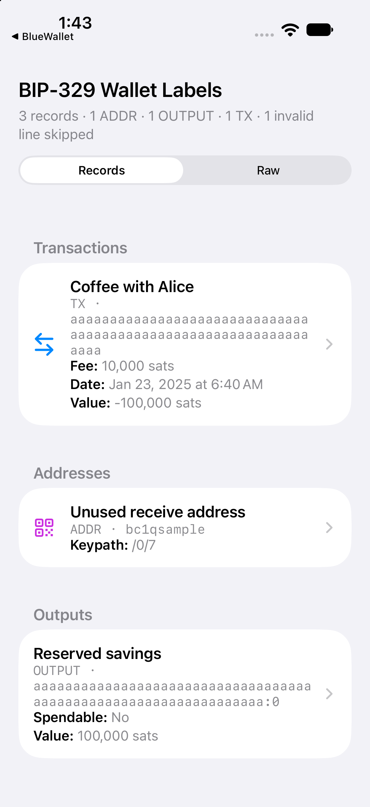
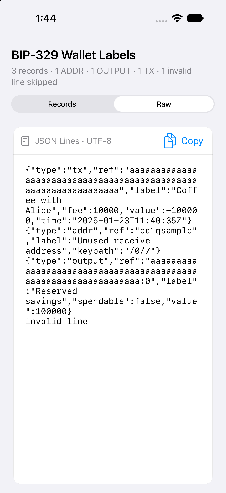

Wallet history review verification
================================

The menu screenshot is captured from Wallet Details in the iPhone 18 Pro simulator, cropped to the native popup. The preview screenshots use public sample records and the production `PreviewViewController`, hosted by the native smoke test.









Native preview smoke test (boot an iOS simulator first; commands below use Apple Silicon):

```sh
preview_test_dir=$(mktemp -d)
mkdir -p "$preview_test_dir/PreviewSmoke.app"
cp ios/QuickLookPreviewTests/Info.plist "$preview_test_dir/PreviewSmoke.app/Info.plist"
xcrun --sdk iphonesimulator swiftc -target arm64-apple-ios18.0-simulator -parse-as-library \
  ios/QuickLookPreview/PreviewViewController.swift \
  ios/QuickLookPreview/ScriptDescription.swift \
  ios/QuickLookPreviewTests/PreviewSmokeTests.swift \
  -o "$preview_test_dir/PreviewSmoke.app/PreviewSmoke"
codesign --force --sign - "$preview_test_dir/PreviewSmoke.app"
xcrun simctl install booted "$preview_test_dir/PreviewSmoke.app"
xcrun simctl launch --console booted io.bluewallet.preview-smoke
```

The test checks that invalid PSBT/transaction files and unreadable files throw, valid JSONL produces three record sections, malformed JSONL lines are counted, and Raw displays the original contents. Success prints `PASS` and writes `tmp/preview-smoke-results.txt` in the test app's data container. Launch with `--raw` to leave the Raw view selected for inspection.
